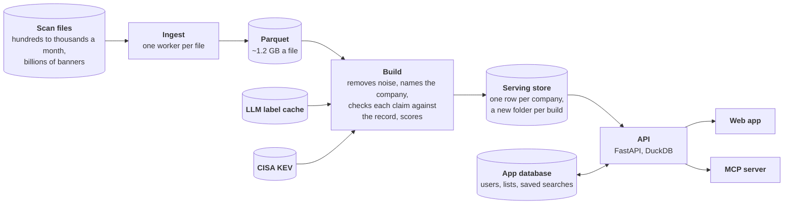
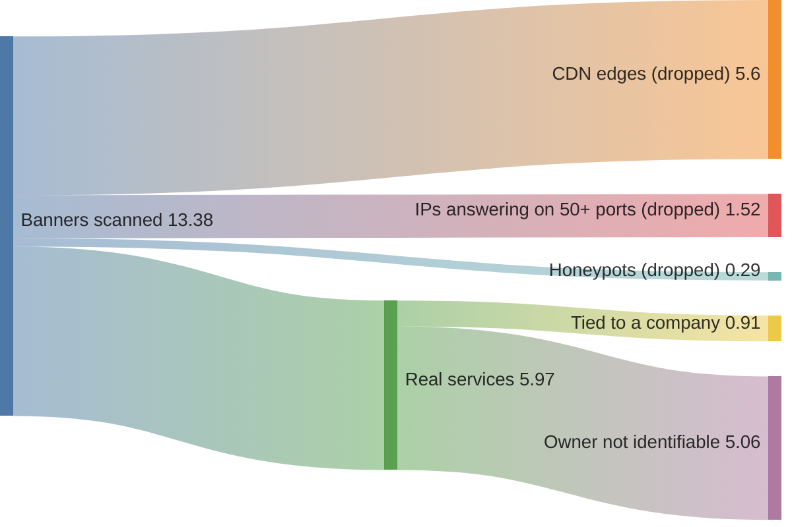

<p align="center">
  
</p>

<h1 align="center">Recon</h1>

<p align="center">
  <strong>Cybersecurity sales intelligence from internet scan data.</strong><br />
  Which companies need security help right now, why, and the evidence to open the conversation with.
</p>

<p align="center">
  
  
  
  
  
</p>

<p align="center">
  <a href="#how-recon-works">How it works</a> ·
  <a href="#the-data-we-were-given">The data</a> ·
  <a href="#results">Results</a> ·
  <a href="#key-decisions">Key decisions</a> ·
  <a href="docs/architecture.md">Architecture</a> ·
  <a href="#mcp-server">MCP server</a>
</p>

<p align="center">
  
  <br /><sub>A one-minute walkthrough (<a href="docs/media/walkthrough.mp4">MP4, full resolution</a>).</sub>
</p>

Recon reads internet scan data and tells a security seller which companies to call this week. For
each company it shows what's exposed, where, and why it matters, and it never invents a finding: every
line a seller can send comes from something the scan actually saw.

From one file of 13.4M scan records, Recon finds 39,190 companies with real security problems. Blind
reviewers rejected 6% of the claims it makes about them, against 44% when the scanner's own labels
are taken at face value, and 72% of its top accounts are real, correctly named companies.

**Built with:** Python 3.12, FastAPI and DuckDB for the pipeline and the API; React 19 and TypeScript
(Vite, on the Node.js 22 toolchain) for the app; SQLite for users' lists; the MCP Python SDK; Claude
Haiku through the Anthropic SDK, with Pydantic-typed outputs, for labelling.

## Features

- A ranked market of companies with real security problems, and ready-made searches for one buying
  trigger at a time: an exposed firewall with exploited CVEs, on-prem Exchange, legacy Windows.
- An ideal customer profile you set in one sentence. It filters everything, and every option shows how
  many accounts it would leave you.
- Filters that take several values, and saved searches that tell you what's new since you last looked.
- Lists you build from rows or from a whole search, with a status per account and CSV export.
- Search a CVE from the news, by id or by name ("Citrix Bleed"), and see who runs the affected software.
- For each account: a peer rank, the evidence, an opening line, and a one-page exposure brief to send.
- An MCP server, so the same search and the same lists work from Claude or any MCP client.

## Screens

<table>
  <tr>
    <td width="50%"><br /><sub><b>Ideal customer profile.</b> Every choice shows what it would give.</sub></td>
    <td width="50%"><br /><sub><b>Signal template.</b> One buying trigger, its pitch and a real example.</sub></td>
  </tr>
  <tr>
    <td><br /><sub><b>Filters.</b> Several values each, a count on every option.</sub></td>
    <td><br /><sub><b>Lists.</b> Every row shows its lists and status.</sub></td>
  </tr>
  <tr>
    <td><br /><sub><b>An account.</b> Peer rank, score breakdown and an opening line.</sub></td>
    <td><br /><sub><b>Saved search.</b> Shows what's new since the last run.</sub></td>
  </tr>
  <tr>
    <td><br /><sub><b>CVE in the news.</b> Today's KEV status and the accounts exposed.</sub></td>
    <td><br /><sub><b>Exposure brief.</b> What anyone on the internet can see.</sub></td>
  </tr>
</table>

## Quick start

**Prerequisites:** [uv](https://docs.astral.sh/uv/), Node.js 22+, and the scan file.

```bash
uv sync
uv run python -m ingest.extract <scan-file> data/parquet/scan-2026-11-01   # ~15 min, flat memory
uv run python -m pipeline.build "data/parquet/scan-*/*.parquet" data/build/full
uv run python -m pipeline.export data/build/full                            # serving store, ~20 s
export RECON_USERS="you:$(uv run python -m api.workspace hash)" RECON_SECURE_COOKIE=0
uv run uvicorn api.app:app --port 8787                                      # API, docs at /api/docs
cd web && npm install && npm run dev                                        # http://localhost:5173
```

Tests: `uv run pytest`. MCP server: `uv run python -m mcp_server.server`. Benchmark: `uv run python -m api.bench`.

## How Recon works



1. **Ingest.** Each scan file is streamed once into Parquet, about 40 fields per record. A compressed
   file can't be split, so each file is one job, and a month of files is a queue of them.
2. **Keep 30 days of observations.** A file is a few hours of an ongoing crawl. Recon keeps the latest
   sighting of each service from the last 30 days, and calls a service new when it first appears on an
   IP the crawl already knew.
3. **Drop the noise, keep only what the record shows.** CDN edges, IPs that answer on every port,
   honeypots and Tor relays go. A CVE, an end-of-life claim or an exposed protocol counts only when the
   record itself shows it (more on why below).
4. **Find the company.** Its own TLS certificate first, then a leaked Active Directory domain, then the
   HTTP host, then the owner of the IP block, carried across the ports of one IP. An LLM decides what
   rules can't, such as whether a name is a carrier, a hoster or a business.
5. **Score and tier.** Weighted signals, raised by known-exploited CVEs, end-of-life software and new
   exposure, and adjusted for how sure the identity is. P1 is the 500 accounts a team can call in a week.
6. **Serve.** Each build becomes a new IP-masked folder, swapped in at once. One API serves the app
   and the MCP server, a page at a time.

The full flow, the serving layer and the production path are in [docs/architecture.md](docs/architecture.md).

## The data we were given

One file: 13,384,515 banners, about five hours of an internet-wide crawl over 4.1M IPs
(2026-10-31 21:13 to 2026-11-01 02:06 UTC, 17 GB compressed). Before writing any pipeline code I
profiled a 1% sample, to learn what a record really says before deciding what to build. Four findings
shaped everything that followed.



**1. Most of the file isn't real.** 42% of records are CDN edges that answer on every port, so the
scanner "finds" trojans and industrial controllers on Cloudflare. 11% are IPs answering on more than
50 ports, and 2% are honeypots carrying up to 170 fake CVEs each. Any ranking that counts findings puts
these decoys first. *So the first stage of Recon removes them, whole IPs at a time.*

**2. The owner on record is the wrong company.** The WHOIS organisation and reverse DNS name the ISP
or the hoster, not the buyer. The real name is in the company's own TLS certificate, a leaked Active
Directory domain or its HTTP host. And the most valuable finding, a firewall's admin page, usually
carries only the vendor's certificate, while port 443 on the same IP names the company. *So identity
comes from the company's own services, carried across the ports of one IP. That's what turns an
anonymous FortiGate into an account you can call.*

**3. The scanner's own labels are guesses.** Its CVE list is inferred from version numbers, and it
verified 1.5% of them. Nearly half sit on Ubuntu, Debian or Red Hat packages, which get fixed without
the version number changing. Its "end-of-life" tag marks Ubuntu 24.04's supported nginx and misses
CentOS 7, and its "industrial controller" on port 3001 is a web page 70% of the time. A seller repeats
these claims to a security engineer, who will check. *So Recon treats every label as a lead, and
claims only what the record shows: the version on the banner, the OS release a package version pins,
a reply in the protocol.*

| | Claims a blind reviewer rejected | Top accounts that are real, named companies |
| --- | --- | --- |
| Taking the scanner's labels at face value | 44% | 60% |
| Recon | 6% | 72% |

[How this was measured →](docs/technical-notes.md#8-how-it-was-measured)

**4. What's left says "call now".** Once the noise and the guesses are gone, the findings that predict
an incident are clear, and they became Recon's signal categories, in order of urgency:

- **Breach:** ransomed databases, trojans and cryptominers, i.e. already compromised.
- **Edge:** firewalls and VPNs reachable from the internet, the most common way ransomware gets in,
  and worse on a known-exploited version.
- **Exposure:** remote desktop, databases, file shares, industrial devices, and 1,700 self-hosted AI
  apps and MCP servers open to anyone.
- **Vulnerability and end of life:** software that's exploitable or past support.
- **Hygiene:** expired certificates and old TLS. These never rank an account on their own; they show a
  thin security team.

Each category maps to a buying trigger, and each trigger became a template a seller can start from:
"firewall with exploited CVEs", "on-prem Exchange", "legacy Windows".

39,190 companies in the file have a material risk signal. Every rule and threshold is in
[docs/technical-notes.md](docs/technical-notes.md).

## Results

**How accounts are scored.** Each finding has a weight for how likely it is to lead to an incident
soon: evidence of a breach first, then a firewall or VPN on a known-exploited version, exposed remote
access and databases, exploitable CVEs, end of life, and hygiene last. Repeats of a finding count with
diminishing returns. Urgency rises with known-exploited CVEs, end-of-life software and new exposure,
and fit reflects how sure the identity is and how large the estate. Tiers follow sales capacity: P1 is
the 500 accounts a team can call in a week.

**How I validated it.** There are no sales outcomes for a take-home, so I tested the two things a
seller depends on, with blind AI reviewers: agents that never saw Recon's code or rules, judging random
top-tier accounts from a seeded sample that was never used for tuning, against a fixed rubric.

First, are the top accounts real, correctly named companies?

| Pipeline | Sellable |
| --- | --- |
| Rules only | 43% (26/60) |
| + LLM labels for organisation type | 53% (32/60) |
| + IP-owner identities need an education or government label | 62% (37/60) |
| Recon, final build (fresh sample) | 72% (43/60) |

Then, is what Recon says about them true? Each risk claim was judged against the raw record behind it:

| | Claims rejected | Claims confirmed |
| --- | --- | --- |
| Taking the scanner's labels at face value | 44% (59/135) | 46% |
| Recon | **6% (8/131)** | **71%** |

The rest are "unclear": all of them two PHP CVEs CISA listed in late October 2026 without affected
versions. With 60 accounts the margin is about ±12 points. The LLM labels agreed with the blind
reviewers on carrier versus business 83 to 87% of the time, and labelling 7,328 names with Claude Haiku
cost $0.26 to $1.28 (how I'd cut that further in production, with the Batch API and a cheap
first-stage classifier, is in [the technical notes](docs/technical-notes.md#7-where-an-llm-is-used-how-its-checked-and-what-it-costs)). Every sample, verdict and step is in
[docs/technical-notes.md](docs/technical-notes.md#8-how-it-was-measured), including a scoring change
that made things worse and was reverted.

**In production, outcomes join the score.** Every account already carries a seller's status (to
contact, contacted, meeting booked, not a fit). In production I'd add a performance term: how accounts
like this one have done lately (meetings booked against not-a-fit, by signal, template, industry and
size), with recent outcomes counting more. A trigger that keeps booking meetings rises; one that keeps
coming back "not a fit" sinks. The blind reviews stand in for that until real outcomes exist.

The MCP tools were tested the same way: given only the tool schemas, does an assistant make the right
first call for a salesperson's request?

| First call correct | First descriptions | Revised, same 18 | Revised, 12 new | Ten tools, 40 requests | Eleven tools, 52 requests |
| --- | --- | --- | --- | --- | --- |
| Claude Sonnet | 10/18 | 17/18 | 12/12 | 40/40 | 51/52 |
| Claude Haiku | 8/18 | 18/18 | 12/12 | 40/40 | 52/52 |

The 12 requests added for the eleven-tool server (several values in one filter, estate size, "not in
my lists", the profile, statuses, removing from a list, opening lines) were all answered right by both
models; Sonnet's one miss is a request the very first rubric scored strictly ("Look up Toyota" answered
with `get_account("toyota.com")`, which works). [Every run →](mcp_server/eval/results.md)

## Key decisions

- **DuckDB for the build and the API.** The work is scans and joins over millions of rows. DuckDB runs
  in-process, reads Parquet where it sits and spills to disk, so the full build runs on an 8 GB laptop.
  It's plain SQL, so it moves to BigQuery or ClickHouse when one machine isn't enough. Spark would be
  more to run than this volume needs.
- **Time decides what's current, not files.** One file is five hours of crawl, so "the last three
  files" would be meaningless. Recon keeps 30 days of observations instead.
- **Identity from the company's own services.** WHOIS names the ISP; certificates and leaked domains
  name the buyer.
- **Rules for scoring, an LLM only where rules can't know.** There are no outcomes to learn from, and a
  seller has to be able to say why an account is hot. The LLM labels distinct names once, in a cached
  batch, so nothing calls a model when a page loads.
- **A claim needs the record behind it.** A seller repeats what Recon says to a security engineer, who
  will check. Taken at face value, the scanner's labels make 83,934 companies look at risk; checked
  against the record, 39,190 are, and blind reviewers reject 6% of the claims instead of 44%.
- **P1 is sized to what a team can call.** 500 accounts a week, not a percentile that grows with the
  market.
- **Evidence instead of generated outreach.** The opening line and the brief are filled from findings,
  so they can't claim something the scan didn't see.
- **IPs masked to /24, nothing served without sign-in.** A public list of vulnerable hosts is a target
  list.
- **Agents, not a chatbot.** I put LLMs where they change the result, not in a chat window on top. In
  the pipeline, Claude Haiku labels every organisation name rules can't classify, with measured
  accuracy and logged cost. In the development loop, independent agents audited every signal against
  the raw records and blind reviewers measured each fix. For sellers, the MCP server gives any
  assistant Recon's search, accounts, lists and statuses as eleven deterministic tools, so "find UK
  firewall accounts with exploited CVEs and add them to my list" is one request (51 and 52 of 52 test
  requests answered with the right first call). Next would be
  agents that work unasked: one that re-runs each template when a new scan lands and briefs the seller
  on what changed, and one that turns an account's evidence into a call plan.

SQLite versus Postgres for users' work, the count cube and the other serving choices are in
[docs/architecture.md](docs/architecture.md).

## Built for growth

The served table grows with companies, not with banners, so the read side stays fast long after the
raw data reaches billions of records. Every list, count and badge comes from one read API over a
versioned Parquet store, and the counts the app asks for most come from a pre-aggregated cube.
Measured on the real store and on synthetic ones 10× and 100× its size (median ms, one laptop):

| Query | 83,744 accounts | 837,440 | 8,374,400 |
| --- | --- | --- | --- |
| Template counts and profile badges (cube) | 0.8 / 3.2 | 0.8 / 3.3 | 0.8 / 3.3 |
| Ranked page, template + profile | 7.4 | 23 | 91 |
| Toolbar badges | 4.0 | 12 | 91 |
| Name search | 9.8 | 29 | 158 |
| Account, evidence | 3.0, 1.8 | 5.3, 2.6 | 37, 20 |

What changes for a full stream of files and many users, and when, is in
[docs/architecture.md](docs/architecture.md#7-the-production-path), including how I'd trace every
request end to end across the services with OpenTelemetry: a seller's request from the assistant
through the MCP server, the API and the database, and each scan file from arrival to the accounts it
changes.

## MCP server

Everything a seller does while prospecting in the app, they can ask their assistant for: the same
filters (several values in one, estate size, "not in my lists"), their ideal customer profile applied
by default, accounts with an opening line, lists, statuses and saved searches. Eleven tools over the
same data and the same user lists as the app; the assistant handles the language, and the tools are
plain queries, so nothing on Recon's side runs a model. The hosted app serves it at `/mcp`:

```bash
claude mcp add --transport http recon https://<host>/mcp --header "Authorization: Bearer <token>"
```

| Tool | Returns |
| --- | --- |
| `dataset_overview()` | The scan and how many records survived each step |
| `list_signal_templates(product)` | Templates, with those built for your product first |
| `search_accounts(template, country, industry, sector, software, size, ...)` | Ranked accounts, the profile applied, a link to the same view |
| `get_account(account_id)` | Score breakdown, peer rank, evidence by signal, an opening line |
| `cve_exposure(cve_or_name, ...)` | CVE facts and affected accounts |
| `make_list(account_ids or template + filters, list_name)` | Adds accounts, or a search's results, to a list |
| `my_lists()` | The seller's lists and what's new in each saved search |
| `save_search(name, template, filters)` | A saved search the seller can re-run in the app |
| `whats_new(saved_search, mark_reviewed)` | Accounts new since the last review and in no list |
| `update_accounts(account_ids, status, remove_from_list)` | Sets statuses (contacted, meeting booked…) or removes from a list |
| `export_crm_tasks(account_ids)` | CRM call tasks as CSV, filled from the evidence |

A seller's week in plain requests ("find UK or Irish companies with an exploited firewall that I
haven't listed", "I booked a meeting with bbc.com", "Citrix Bleed is in the news: who's exposed?") and
the call each becomes: [mcp_server/README.md](mcp_server/README.md#a-sellers-week-in-plain-requests).

## How it was built

I designed Recon: the product, the approach and the scoring. I built it with Claude Code, which wrote
most of the implementation under my direction. What I cared about most was not trusting anything,
the scanner's labels or the AI's output, without checking it:

- I profiled the data before any pipeline code existed ([`analysis/`](analysis/)). Most of the
  findings above came from that; the phantom IPs only showed up on the full file.
- After every full build I had Claude review the top of the ranking. Most identity and noise rules
  started as a wrong account found there.
- When the scanner's labels didn't hold up, I had an independent agent, given the code and the data but
  not my suspicions, audit every signal against its raw records. Each finding was confirmed with a
  query before it changed a rule, and each fix was measured by the blind reviewers.
- Every measurement came from reviewers that never saw the pipeline, on samples never used to tune it.
- LLM cost is logged per run ([`data/labels/llm_usage.json`](data/labels/llm_usage.json)), and the
  read path is benchmarked at 1×, 10× and 100× ([`api/bench.py`](api/bench.py)).

## Documentation

- [Architecture and data flow](docs/architecture.md): ingestion, serving, the production path.
- [Technical notes](docs/technical-notes.md): every signal and rule, scoring, the LLM step and how it
  was measured.
- [MCP evaluation](mcp_server/eval/results.md): the requests, the accepted answers and the runs.

## Roadmap

- **Signal agents** that re-run each template on every new scan and alert on new matches.
- **Enrichment by domain:** real company size, verified contacts, subsidiaries from certificate
  transparency. It would also fix most of the remaining identity errors (small sites on shared hosting).
- **Vulnerability data instead of hand tables:** distro security trackers and OSV would say exactly
  which fixes a backported package already has.
- **Teams and CRM sync:** shared workspaces on Postgres with SSO, lists synced to the CRM.
