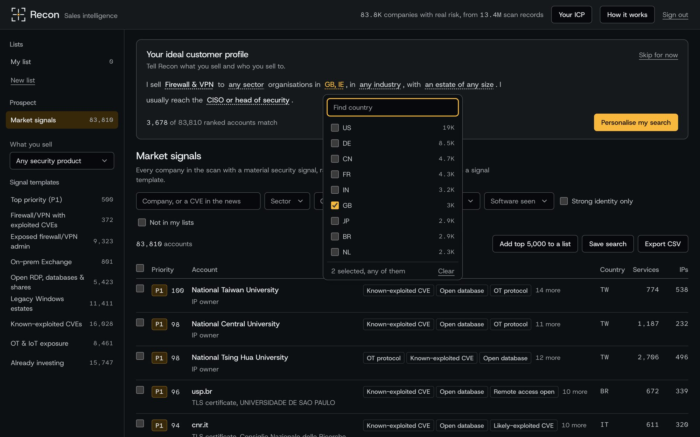
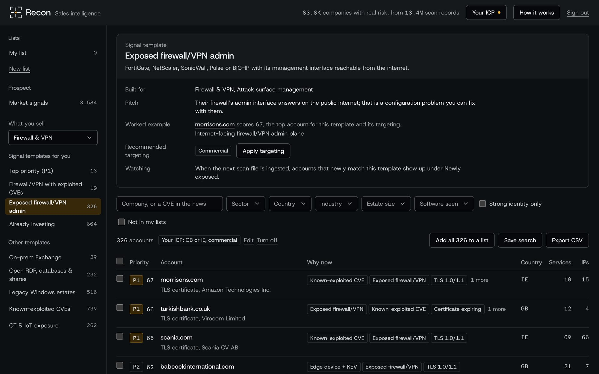
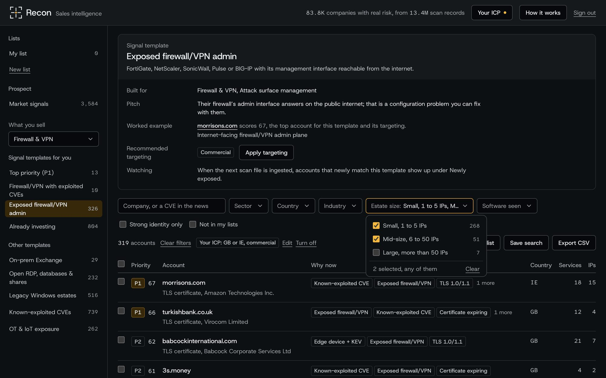
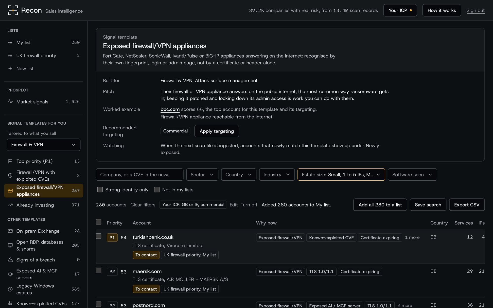
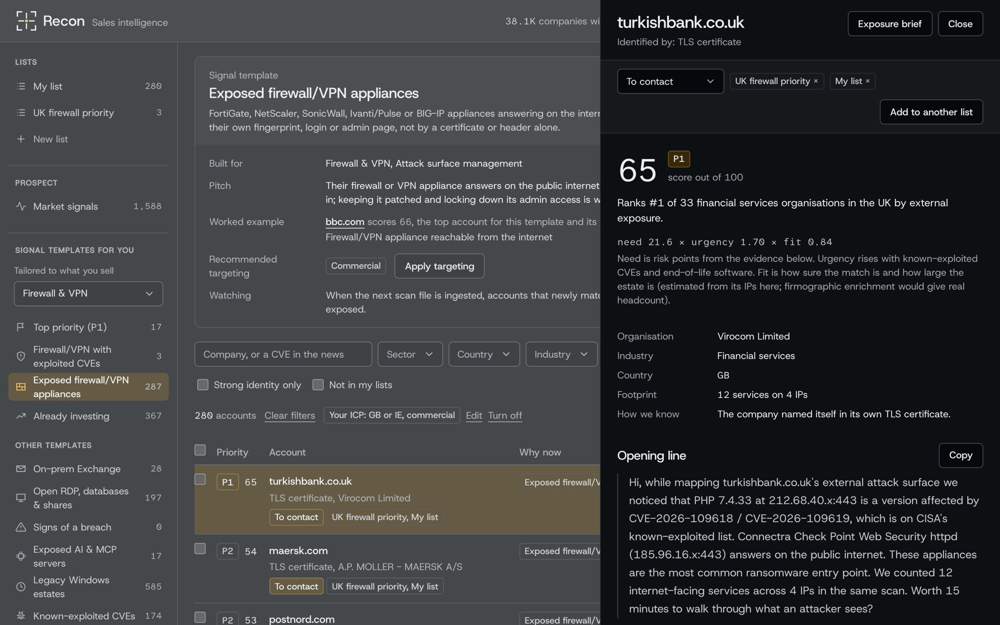
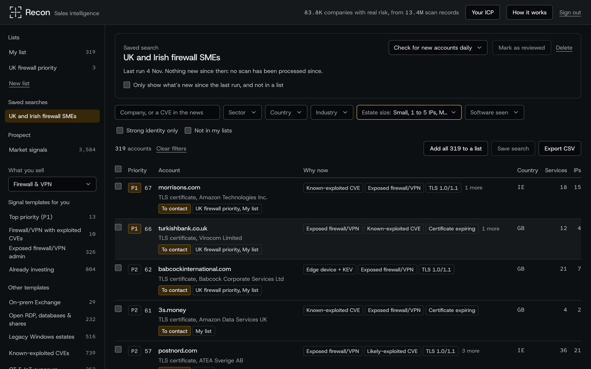
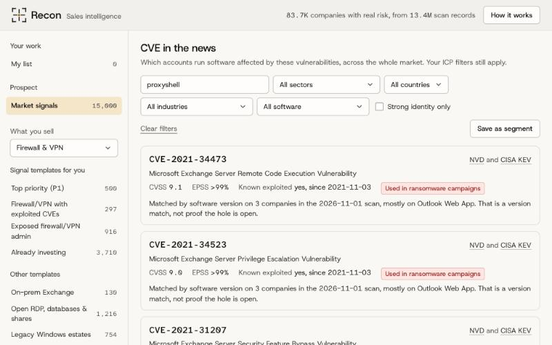
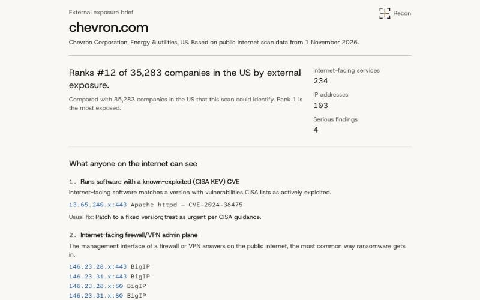
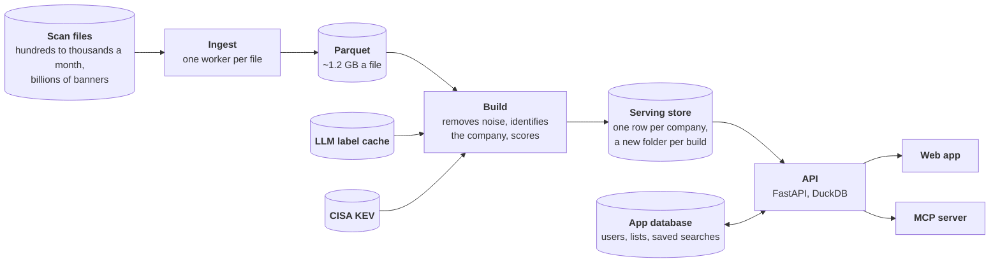
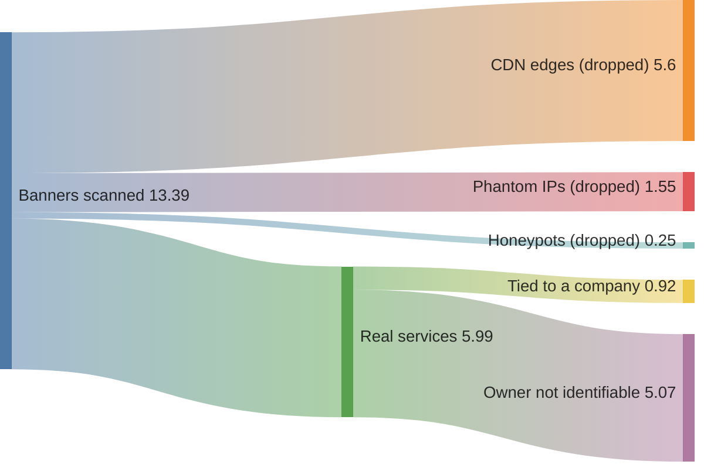

<p align="center">
  
</p>

<h1 align="center">Recon</h1>

<p align="center">
  <strong>Cybersecurity sales intelligence from internet scan data.</strong><br />
  Which companies need security help right now, why, and the evidence to open the conversation with.
</p>

<p align="center">
  
  
  
  
</p>

<p align="center">
  <a href="#how-recon-works">How it works</a> ·
  <a href="#the-data-we-were-given">The data</a> ·
  <a href="#results">Results</a> ·
  <a href="#key-decisions">Key decisions</a> ·
  <a href="docs/architecture.md">Architecture</a> ·
  <a href="#mcp-server">MCP server</a>
</p>

<p align="center">
  
  <br /><sub>A one-minute walkthrough (<a href="docs/media/walkthrough.mp4">MP4, full resolution</a>).</sub>
</p>

Recon turns a stream of internet scan data (Shodan-style banners, one per IP and port) into a ranked
market of companies that need security help now. It works out which company runs each internet-facing
service, scores each company by how urgently it needs help, and gives a seller the evidence to open
the conversation with. Every score traces back to a service a salesperson can point to, and nothing a
seller sends is generated: the outreach is the evidence.

## Features

- **Signals that survive the noise.** 42% of the scan is CDN edges that answer on every port, 12%
  is phantom hosts and 1.8% is honeypots with fake CVEs. After those are removed, 20 signals remain,
  led by internet-facing firewall and VPN admin planes, the most common way ransomware gets in.
- **Company identity from the services themselves.** TLS certificates, leaked Active Directory
  domains and HTTP hosts name the company; identity carries across ports of one IP, and hosters and
  ISP customer pools are recognised and excluded.
- **Market signals and signal templates.** The whole ranked market, or a ready-to-run search built
  around one buying trigger (exposed firewalls with exploited CVEs, on-prem Exchange, legacy Windows,
  OT exposure). **What you sell** puts the templates for your product first.
- **Your ideal customer profile.** One sentence, offered in the page on a first visit and never in
  the way: what you sell, where, to whom, estate size and who you call, each choice with a count. It
  narrows every view and count, the CVE search included, sets the roles in the contact searches, and
  can be edited or switched off.
- **Multi-select filters and saved searches.** Every filter takes several values (GB or IE, small or
  mid-size estates), each option showing how many accounts it gives. A saved search remembers the data
  build it last ran on, so it shows what is new since then and not in any of your lists yet.
- **CVE in the news.** Search a CVE id or a name such as "Citrix Bleed" and see which accounts run
  the affected software, with today's CISA KEV status and ransomware use.
- **Peer benchmark.** "Ranks #1 of 112 manufacturing organisations in the US by external exposure",
  over every scored company, with the peer group always named.
- **Exposure brief.** A printable page of what anyone on the internet can see about an account, what
  each finding means and the usual fix: the asset a seller sends.
- **Lists and CRM export.** Several named lists, kept per user on the server; every table shows which
  lists an account is in and its status (to contact to meeting booked). Pick rows or take a whole
  search into a list, and export a list or any search as CSV.
- **MCP server.** Prospect from Claude or any MCP client, including building lists and checking saved
  searches for what's new; they are the same lists the seller opens in the app.
## Screens

<table>
  <tr>
    <td width="50%"><br /><sub><b>Ideal customer profile.</b> One sentence in the page; every choice shows what it would give.</sub></td>
    <td width="50%"><br /><sub><b>Signal template.</b> One buying trigger, the pitch, a real worked example and recommended targeting.</sub></td>
  </tr>
  <tr>
    <td><br /><sub><b>Multi-select filters.</b> OR within a filter, AND across, a count on every option.</sub></td>
    <td><br /><sub><b>Lists.</b> Pick rows or take a whole search; every row shows its lists and status.</sub></td>
  </tr>
  <tr>
    <td><br /><sub><b>An account.</b> Why now, peer rank, score breakdown, an opening line built from the evidence.</sub></td>
    <td><br /><sub><b>Saved search.</b> Remembers the build it ran on, so the next run shows what's new.</sub></td>
  </tr>
  <tr>
    <td><br /><sub><b>CVE in the news.</b> An id or a name such as ProxyShell, with today's KEV status and the accounts exposed.</sub></td>
    <td><br /><sub><b>Exposure brief.</b> A printable page of what anyone on the internet can see, and the usual fix.</sub></td>
  </tr>
</table>

## Quick start

**Prerequisites:** [uv](https://docs.astral.sh/uv/), Node.js 22+, and the scan file.

```bash
uv sync
uv run python -m ingest.extract <scan-file> data/parquet/scan-2026-11-01   # ~15 min, flat memory
uv run python -m pipeline.build "data/parquet/scan-*/*.parquet" data/build/full
uv run python -m pipeline.export data/build/full                            # serving store, ~20 s
export RECON_USERS="you:$(uv run python -m api.workspace hash)" RECON_SECURE_COOKIE=0
uv run uvicorn api.app:app --port 8787                                      # API, docs at /api/docs
cd web && npm install && npm run dev                                        # http://localhost:5173
```

Tests: `uv run pytest`. The MCP server: `uv run python -m mcp_server.server` (registered for Claude
Code through `.mcp.json`). Benchmark: `uv run python -m api.bench`.

## How Recon works



1. **Ingest each file once.** Hundreds to thousands of files a month, billions of banners. Each file
   is streamed with flat memory into about 40 fields of Parquet and never read again. A compressed file can't be split, so the file is the unit of work: a stream of
   files is a queue of independent workers.
2. **Keep a window of observations.** A file is a few hours of an ongoing crawl, not a re-scan of the
   internet, so the build keeps the latest observation of each service from the last 30 days. A
   service first seen this week, on an IP the crawl already knew, is newly exposed.
3. **Remove noise.** CDN edges that answer on every port, IPs answering on more than 50 ports,
   honeypots advertising fake CVEs, and CVEs matched on nearly every server of a type.
4. **Identify the company.** From its own services: the TLS certificate, then a leaked Active Directory
   domain, then the HTTP host, then the IP block's owner, carried across the ports of one IP. Hosters
   and ISP customer pools are excluded. An LLM settles what rules can't (is this name a carrier, a
   hoster or a business, and in what industry) as a cached batch over distinct names.
5. **Score.** `need × urgency × fit`: weighted signals with diminishing returns, raised by
   known-exploited CVEs, end-of-life software and new exposure, adjusted for how sure the identity is.
   Tiers follow sales capacity: P1 is the 500 accounts to call this week.
6. **Publish and serve.** Each build becomes a versioned, IP-masked serving store, swapped in
   atomically. A read API answers the app and the MCP server from it, one page at a time.

The full flow, the serving layer and the production path are in [docs/architecture.md](docs/architecture.md).

## The data we were given

One real file of the kind the brief says arrives hundreds to thousands of times a month: 13,384,515
banners, 17 GB of zstd (118 GB of NDJSON), covering about five hours of crawl over 4.1M IPs
(2026-10-31 21:13 to 2026-11-01 02:06 UTC). It was profiled on a 1% systematic sample before any
pipeline code was written, ingested once (15 minutes on an 8 GB laptop) and built in about 4 minutes.

Where the records go (millions of banners):



What the file hides, and what Recon does about it:

- **Most of it is not real.** 42% of records are CDN edges answering on every port (so the scanner
  "finds" remote-access trojans and PLCs on Cloudflare), 12% are IPs answering on more than 50 ports,
  and 1.8% are honeypots with 80 to 170 fake CVEs each. A ranking by CVE count puts the decoys first.
- **Two "known-exploited" CVEs are noise.** HTTP/2 Rapid Reset is matched on nearly every nginx, and
  the jQuery CVEs come from a script on the page, not the server. Counted, they make "KEV" meaningless.
- **The owner on record is usually the ISP.** The WHOIS organisation and reverse DNS name the carrier
  or hoster, not the buyer. The company's own name is in its TLS certificate, a leaked Active
  Directory domain or its HTTP host.
- **The strongest signal names nobody.** A FortiGate admin interface on port 541 or 10443 has a vendor
  default certificate; port 443 on the same IP names the company. Carrying identity across the ports
  of one IP turns the most common ransomware entry point into a named account.
- **Leaked AD domains do double duty.** An NTLM handshake gives away the internal domain (a name for
  the company) and the Windows build (an end-of-life operating system).
- **Security maturity changes the pitch, not the rank.** A WAF, a security.txt or post-quantum TLS
  marks a buyer with a team: a consolidation conversation, not a first purchase.

The result: 917k services tied to 298k companies, and 83,810 companies with a material risk signal.
Every signal, threshold and rule is in [docs/technical-notes.md](docs/technical-notes.md).

## Results

There are no sales outcomes to test against, so the measure is **precision**: of the top-tier
accounts, how many could a seller actually prospect? Seeded samples of 60 were labelled blind by a
reviewer with no view of the pipeline, and each change was measured on a fresh sample that hadn't
influenced any tuning.

| Pipeline | Top-tier precision |
| --- | --- |
| Rules only | 43% (26/60) |
| + LLM labels for organisation type | 53% (32/60) |
| + IP-owner identities need an education or government label | 62% (37/60) |
| Final build (deterministic identity), same holdout | 61% (36/59) |

With 60 accounts the margin is about ±12 points, so the gain is real and the middle step indicative.
Each sample pointed at the next fix: the first showed that IP-owner identities were 15% sellable, the
second that labels alone didn't fix them except for universities and governments. The remaining errors
are single-IP personal sites. The LLM agreed with the blind reviewer on carrier versus business 83 to
87% of the time, at a cost of about $0.15 to $0.75 for 4,430 names with Claude Haiku.

The MCP server was tested the same way: given only the tool schemas, does an assistant make the right
first call for a salesperson's request? The first run exposed two description problems; the revised
tools were then tested on 12 requests written before the re-run. The full ten-tool server, with lists
and saved searches, was tested on all 30 plus 10 new list requests.

| First call correct | First descriptions | Revised, same 18 | Revised, 12 new | All ten tools, 40 requests |
| --- | --- | --- | --- | --- |
| Claude Sonnet | 10/18 | 17/18 | 12/12 | 40/40 |
| Claude Haiku | 8/18 | 18/18 | 12/12 | 40/40 |

CVE search returns exactly the companies a direct query over the build finds (four CVEs, one of them on
24,291 companies), and peer ranks were recomputed independently.
## Key decisions

- **DuckDB, for the build and the API.** The work is analytical: scans, joins and aggregates over
  millions of rows, run in batch and then read. DuckDB runs inside the process with no server to
  operate, queries Parquet where it sits, reads only the columns and row groups a query needs, and
  spills to disk, so the full 13.4M-row build runs in about 4 minutes on an 8 GB laptop without the
  data ever having to fit in memory. The work stays in plain SQL, so it moves to a warehouse (BigQuery,
  ClickHouse) when one machine is no longer enough, and one dialect serves the batch build and the
  API. Spark is more to operate than this volume needs; Postgres would add a load step and a row store
  for a column-shaped workload.
- **Time, not files, defines what is current and what is new.** The file covers five hours of crawl,
  so "the last three files" would be fifteen hours of the internet. Retention is 30 days of
  observations, and "new" needs an IP the crawl had already seen, so a file that covers a fresh range
  doesn't light up as newly exposed.
- **Identity from the company's own services, carried across ports.** WHOIS names the ISP. Certificates,
  leaked AD domains and HTTP hosts name the company, and the same-IP carry is what turns an anonymous
  FortiGate admin port into a named account.
- **Rules for scoring, an LLM only for what rules can't know.** There are no outcome labels to learn
  from, and a seller has to be able to say why an account is hot. The LLM classifies distinct names
  (carrier, hoster, business; industry) as a cached batch, so its cost grows with new names, not
  records, and nothing calls a model when a page loads.
- **Measured on blind, fresh holdouts.** Each change was judged on a sample that hadn't influenced any
  tuning, labelled by a reviewer who never saw the pipeline (the precision table above).
- **Tiers sized to sales capacity.** P1 is 500 accounts, what a team can call in a week, not a
  percentile that grows with the market.
- **Evidence instead of generated outreach.** The opening line and the brief are filled from findings,
  so neither can claim a vulnerability the scan didn't see.
- **IPs masked to /24 in everything served, and nothing served without sign-in.** A public list of
  vulnerable hosts is a target list, and an unlisted URL isn't private: its TLS certificate is in the
  public Certificate Transparency logs that scanners watch.
- **SQLite for users' work in this deployment, Postgres in production.** Lists, statuses and saved
  searches are small, frequent writes that must not be lost: a row store with transactions, not the
  column store the scan data uses. One API host makes SQLite (WAL mode) enough and serverless;
  several API instances and shared team lists are where Postgres takes over. The queries are portable
  SQL in one module, and every row carries a workspace, so teams are a membership table away.
- **Counts from a pre-aggregated cube, "new" from the data.** The queries the app sends most cost the
  same at any number of accounts, and each account records the build it was first ranked in, so a
  saved search finds what is new with one filter instead of storing old results per user.
- **An MCP server rather than a chatbot in the app.** The assistant does the language; the tools are
  deterministic queries over the same layer as the API, evaluated on held-out requests.

## Built for growth

The data grows with every file, so nothing the app or an assistant reads is sized by the market:

- **A read API** ([`api/`](api/)) answers every list, count and badge with DuckDB over a versioned,
  IP-masked Parquet store. The browser holds one page at a time, and all 83,810 risky companies are
  served.
- **A count cube** answers the template counts and the profile badges. It grows with the number of
  country × sector × industry × size combinations, not with accounts.
- **New builds land atomically.** The export writes a new folder, checks it (no full IPs, unique ids,
  no orphan evidence) and moves a pointer; the API picks it up without a restart.

Measured over the real store and synthetic stores 10× and 100× its size (median ms, one laptop,
`uv run python -m api.bench`):

| Query | 83,744 accounts | 837,440 | 8,374,400 |
| --- | --- | --- | --- |
| Template counts and profile badges (cube) | 0.8 / 3.2 | 0.8 / 3.3 | 0.8 / 3.3 |
| Ranked page, template + profile | 7.4 | 23 | 91 |
| Toolbar badges | 4.0 | 12 | 91 |
| Name search | 9.8 | 29 | 158 |
| Account, evidence | 3.0, 1.8 | 5.3, 2.6 | 37, 20 |

The served table grows with companies, not banners, so the read side meets millions long before
billions; the billions of raw records stay in the batch layer (Parquet and SQL that move to a warehouse
unchanged). What changes for a full stream of files and many users, and when, is in
[docs/architecture.md](docs/architecture.md#7-the-production-path).

## MCP server

Ten deterministic tools over the same query layer and app database as the API (IP-masked). The
assistant handles the language; nothing runs a model or costs per call on Recon's side. The hosted app
serves it at `/mcp`, so a client connects with no setup (the host and token come with the submission):

```bash
claude mcp add --transport http recon https://<host>/mcp --header "Authorization: Bearer <token>"
```

A list Claude builds is the same list the user opens in the app.

| Tool | Returns |
| --- | --- |
| `dataset_overview()` | The scan and how many records survived each step |
| `list_signal_templates(product)` | Templates, with those built for your product first |
| `search_accounts(template, country, industry, sector, software, ...)` | Ranked accounts and a link to the same view |
| `get_account(account_id)` | Score breakdown, peer rank, evidence by signal |
| `cve_exposure(cve_or_name, ...)` | CVE facts and affected accounts, with the product fallback |
| `make_list(account_ids or template + filters, list_name)` | Adds accounts, or a search's top results, to one of the seller's lists |
| `my_lists()` | The seller's lists, and how many accounts are new in each saved search |
| `save_search(name, template, filters)` | A saved search the seller can re-run in the app |
| `whats_new(saved_search, mark_reviewed)` | Accounts new since the search was last reviewed and in none of the lists |
| `export_crm_tasks(account_ids)` | CRM call tasks as CSV, filled from the evidence |

## How it was built

An AI-native loop, with checks at the points where a model's confidence can't be taken on trust:

- **Data first.** The file was profiled on a 1% systematic sample, with profiling queries
  ([`analysis/`](analysis/)), before any pipeline code existed. Most of the traps above came from that;
  the phantom IPs only showed on the full run.
- **Claude Code for implementation and proposals.** It wrote most of the code and proposed designs; I
  set the direction, chose between options and decided what shipped.
- **Review after every full run.** The top of the ranking was read after each build, and most of the
  identity and noise rules started as a wrong account found there.
- **Independent measurement.** Gold labels came from separate agents that never saw the pipeline,
  each change was measured on a fresh holdout, and the MCP tools were tested on requests written
  before the re-run.
- **An independent design review.** A separate agent reviewed the design at 10× to 1,000× the volume;
  every finding was checked against the code and the data before acting on it (the five-hour window
  above came out of that).
- **Costs measured, not estimated.** LLM labelling cost is logged per run (`data/labels/llm_usage.json`),
  and the read path is benchmarked at 1×, 10× and 100× ([`api/bench.py`](api/bench.py)).

## Documentation

- [Architecture and data flow](docs/architecture.md): what happened to this file, continuous ingestion,
  one file arriving, and what is kept, dropped and masked.
- [Technical notes](docs/technical-notes.md): signals and weights, identity rules, scoring, the LLM
  step and its evaluation in detail.
- [MCP evaluation](mcp_server/eval/results.md): the requests, the accepted answers and both runs.

## Roadmap

- **Signal agents:** re-run each template on every new scan and fire on newly matching accounts.
- **Enrichment by domain:** firmographics for real company size, verified contacts, IP-to-company
  data for the estates on ISP lines, certificate transparency for subsidiaries, SPF and DMARC for
  email security sellers.
- **Single-IP precision:** the largest remaining error, measured on a fresh blind sample.
- **Teams and CRM sync:** shared team workspaces on Postgres with SSO, and lists synced to the CRM.
- **Scheduled saved searches:** a worker re-runs each saved search when a build lands and notifies the
  owner of new accounts, through the same API.
