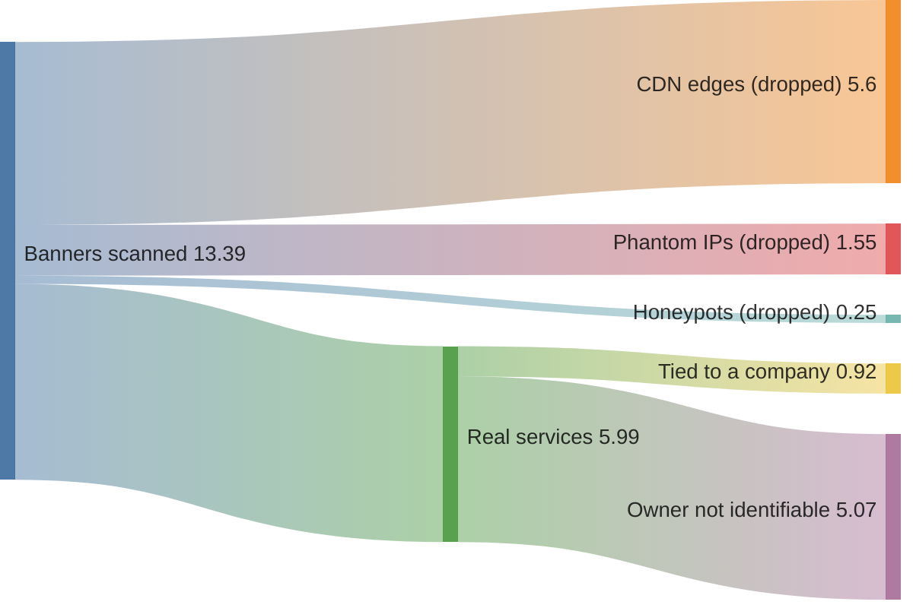
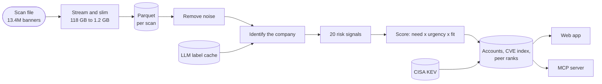

<p align="center">
  
</p>

<h1 align="center">Recon</h1>

<p align="center">
  <strong>Cybersecurity sales intelligence from internet scan data.</strong><br />
  Which companies need security help right now, why, and the evidence to open the conversation with.
</p>

<p align="center">
  
  
  
  
</p>

<p align="center">
  <a href="#how-it-works">How it works</a> ·
  <a href="#results">Results</a> ·
  <a href="docs/architecture.md">Architecture</a> ·
  <a href="docs/technical-notes.md">Technical notes</a> ·
  <a href="#mcp-server">MCP server</a>
</p>

<p align="center">
  
  <br /><sub>A signal template for a firewall seller: exposed VPN admin planes plus known-exploited CVEs, with the top real account as a worked example.</sub>
</p>

Recon reads one day of Shodan-style banners (13.4 million records, one per IP and port), works out
which company runs each internet-facing service, and ranks companies by how urgently they need
security help. Every score traces back to a service a salesperson can point to, and nothing a seller
sends is generated: the outreach is the evidence.

## Features

- **Signals that survive the noise.** 42% of the scan is CDN edges that answer on every port, 12%
  is phantom hosts and 1.8% is honeypots with fake CVEs. After those are removed, 20 signals remain,
  led by internet-facing firewall and VPN admin planes, the most common way ransomware gets in.
- **Company identity from the services themselves.** TLS certificates, leaked Active Directory
  domains and HTTP hosts name the company; identity carries across ports of one IP, and hosters and
  ISP customer pools are recognised and excluded.
- **Market signals and signal templates.** The whole ranked market, or a ready-to-run search built
  around one buying trigger (exposed firewalls with exploited CVEs, on-prem Exchange, legacy Windows,
  OT exposure). **What you sell** puts the templates for your product first.
- **Your ideal customer profile.** Asked once on a first visit: what you sell, where, to whom and
  who you call, with a live count of matching accounts. It narrows every view and count, the CVE
  search included, sets the roles in the contact searches, and can be edited or switched off.
- **ICP filters and segments.** Sector, country, industry and the software they run, saved as
  segments to rerun each week.
- **CVE in the news.** Search a CVE id or a name such as "Citrix Bleed" and see which accounts run
  the affected software, with today's CISA KEV status and ransomware use.
- **Peer benchmark.** "Ranks #1 of 112 manufacturing organisations in the US by external exposure",
  over every scored company, with the peer group always named.
- **Exposure brief.** A printable page of what anyone on the internet can see about an account, what
  each finding means and the usual fix: the asset a seller sends.
- **Lists and CRM export.** Track accounts from to contact to meeting booked, and export call tasks.
- **MCP server.** Prospect from Claude or any MCP client; lists come back as a link into the app.

<p align="center">
  
  <br /><sub>"ProxyShell" resolves to its three CVEs, each with today's CISA KEV status and ransomware use, and the accounts running the affected Exchange.</sub>
</p>

## Quick start

**Prerequisites:** [uv](https://docs.astral.sh/uv/), Node.js 22+, and the scan file.

```bash
uv sync
uv run python -m ingest.extract <scan-file> data/parquet/scan-2026-11-01   # ~15 min, flat memory
uv run python -m pipeline.build "data/parquet/scan-*/*.parquet" data/build/full
uv run python -m pipeline.export data/build/full
uv run python -m pipeline.cve_index data/build/full
cd web && npm install && npm run dev                                        # http://localhost:5173
```

Tests: `uv run pytest`. The MCP server: `uv run python -m mcp_server.server` (registered for Claude
Code through `.mcp.json`).

## How it works

Where the 13.4M records go (millions of banners):





1. **Stream once.** Each file is read once with flat memory into about 40 fields of Parquet: 118 GB
   in 15 minutes at 134 MB/s on an 8 GB laptop. A compressed file can't be split, so the file is the
   unit of work and a monthly stream of files is a queue of independent workers.
2. **Remove noise.** CDN edges, IPs answering on more than 50 ports, honeypots, and the two CVEs that
   are matched on nearly every web server (HTTP/2 Rapid Reset, and a jQuery bug that lives in the page).
3. **Identify the company.** TLS certificate, then leaked AD domain, then HTTP host, then the IP
   block's owner. An LLM settles what rules can't: whether a name is a carrier, a hoster or a real
   business, and its industry, as a cached batch step over distinct names.
4. **Score.** `need × urgency × fit`: weighted signals with diminishing returns, raised by known-
   exploited CVEs, end-of-life software and newly exposed services, adjusted for how sure the identity
   is. Tiers follow sales capacity: P1 is the top 500.
5. **Publish.** Accounts, the CVE index and peer ranks, with every IP masked to /24, for the app and
   the MCP server.

Across several scans the latest observation of each service wins, and a risky service that wasn't in
the previous scan is flagged as new. The full flow for a continuous stream, including what is built
and what is designed, is in [docs/architecture.md](docs/architecture.md).

## Results

There are no sales outcomes to test against, so the measure is **precision**: of the top-tier
accounts, how many could a seller actually prospect? Seeded samples of 60 were labelled blind by a
reviewer with no view of the pipeline, and each change was measured on a fresh sample that hadn't
influenced any tuning.

| Pipeline | Top-tier precision |
| --- | --- |
| Rules only | 43% (26/60) |
| + LLM labels for organisation type | 53% (32/60) |
| + IP-owner identities need an education or government label | 62% (37/60) |

With 60 accounts the margin is about ±12 points, so the gain is real and the middle step indicative.
Each sample pointed at the next fix: the first showed that IP-owner identities were 15% sellable, the
second that labels alone didn't fix them except for universities and governments. The remaining errors
are single-IP personal sites. The LLM agreed with the blind reviewer on carrier versus business 83 to
87% of the time, at a cost of about $0.15 to $0.75 for 4,430 names with Claude Haiku.

The MCP server was tested the same way: given only the tool schemas, does an assistant make the right
first call for a salesperson's request? The first run exposed two description problems; the revised
tools were then tested on 12 requests written before the re-run.

| First call correct | First descriptions | Revised, same 18 | Revised, 12 new |
| --- | --- | --- | --- |
| Claude Sonnet | 10/18 | 17/18 | 12/12 |
| Claude Haiku | 8/18 | 18/18 | 12/12 |

CVE search returns exactly the companies a direct query over the build finds (four CVEs, one of them on
24,291 companies), and peer ranks were recomputed independently.

<p align="center">
  
  <br /><sub>The exposure brief: a peer rank first, then what anyone on the internet can see, each finding with masked evidence and the usual fix.</sub>
</p>

## Key decisions

- **Rules, not a model, for scoring.** There are no outcome labels to learn from, and a seller needs
  to say why an account is hot.
- **An LLM only where rules can't decide**, as a batch step over distinct names, cached, overruling the
  rules only at medium or high confidence. Nothing calls an LLM at page load.
- **Evidence instead of generated outreach.** The opening line and the brief are filled from findings,
  so neither can claim a vulnerability the scan didn't see.
- **IPs masked to /24 in everything published.** A public list of vulnerable hosts is a target list.
- **A static app.** Scoring happens offline; the app filters and displays.

## MCP server

Seven deterministic tools over the published, IP-masked data. The assistant handles the language;
nothing runs a model or costs per call on Recon's side.

| Tool | Returns |
| --- | --- |
| `dataset_overview()` | The scan and how many records survived each step |
| `list_signal_templates(product)` | Templates, with those built for your product first |
| `search_accounts(template, country, industry, sector, software, ...)` | Ranked accounts and a link to the same view |
| `get_account(account_id)` | Score breakdown, peer rank, evidence by signal |
| `cve_exposure(cve_or_name, ...)` | CVE facts and affected accounts, with the product fallback |
| `make_list(account_ids)` | A link that adds the accounts to My list in the app |
| `export_crm_tasks(account_ids)` | CRM call tasks as CSV, filled from the evidence |

## Documentation

- [Architecture and data flow](docs/architecture.md): what happened to this file, continuous ingestion,
  one file arriving, and what is kept, dropped and masked.
- [Technical notes](docs/technical-notes.md): signals and weights, identity rules, scoring, the LLM
  step and its evaluation in detail.
- [MCP evaluation](mcp_server/eval/results.md): the requests, the accepted answers and both runs.

## Roadmap

- **Signal agents:** re-run each template on every new scan and fire on newly matching accounts.
- **Enrichment by domain:** firmographics for real company size, verified contacts, IP-to-company
  data for the estates on ISP lines, certificate transparency for subsidiaries, SPF and DMARC for
  email security sellers.
- **Single-IP precision:** the largest remaining error, measured on a fresh blind sample.
- **CRM sync** for lists and segments, in place of browser storage.

## How it was built

Built with Claude Code doing most of the hands-on work: profiling, pipeline code, the review loop
after each full run, and first drafts. The direction and the product decisions were mine, and the
measurement was kept independent of the code being measured: the blind labels came from separate
agents that never saw the pipeline.
