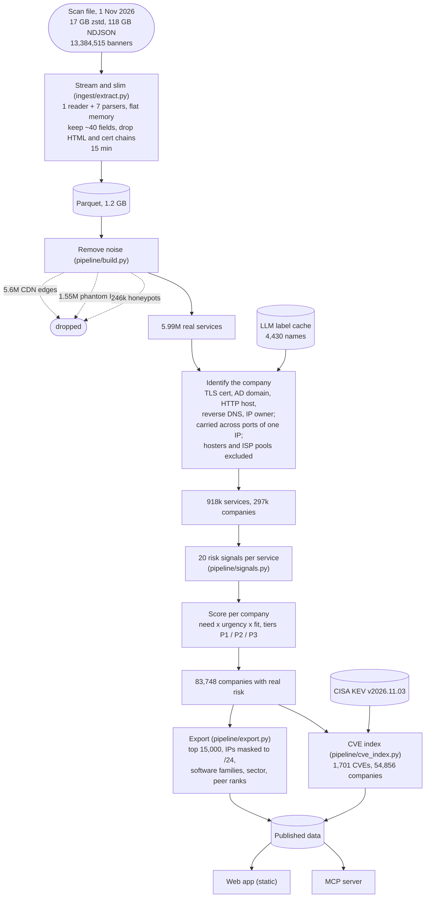
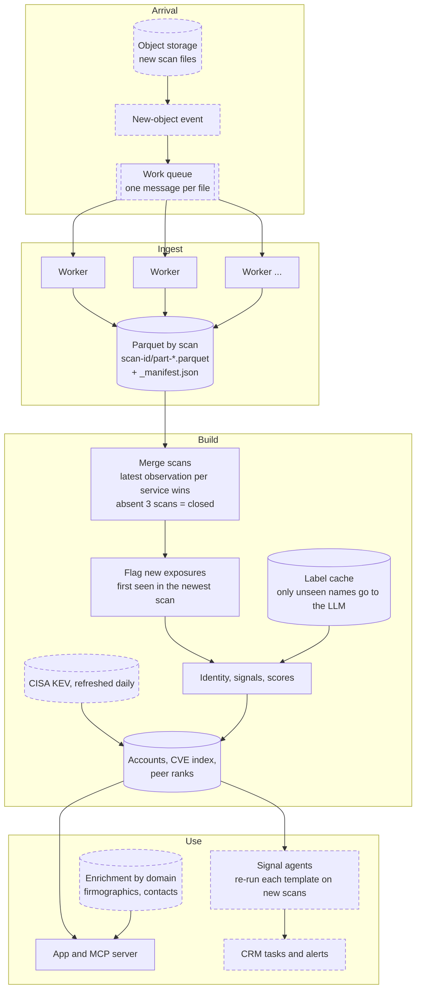
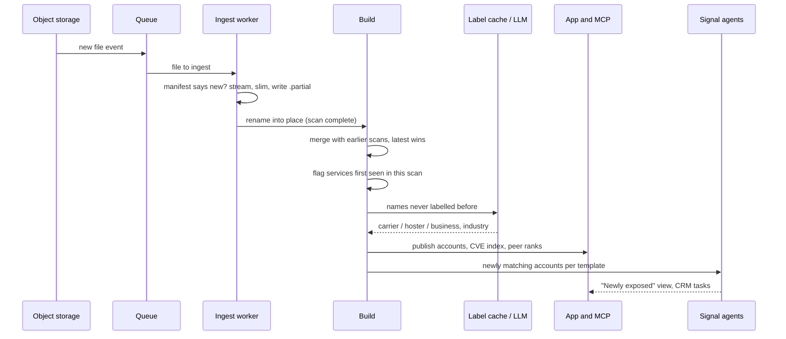
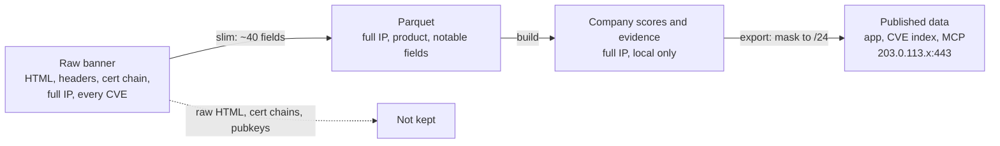

# Recon: architecture and data flow

How a scan file becomes ranked accounts, and how that keeps up when hundreds to thousands of files
arrive each month. Each diagram marks what is **built** (in this repo, run on the supplied file)
and what is **designed** (the production shape the built pieces slot into).

## 1. What happened to this file (built)

One file, 13.4M banners, processed once. The numbers are what each step kept.

## 2. Continuous ingestion (designed around the built pieces)

Files are independent, and a zstd file can't be split, so the file is the unit of work.

Solid boxes are built and ran on the supplied file; dashed boxes are designed. Everything from
"Parquet by scan" onwards is the code in this repo.

**Throughput.** Measured: 118 GB raw in 882 s (134 MB/s) on one 8 GB laptop, about 15 minutes per
file. 1,000 files a month is about 250 machine-hours, roughly a third of one machine running
continuously, so a small worker pool handles bursts. The build is SQL over Parquet (DuckDB), so the
same queries move to a warehouse or DuckDB on object storage when one machine is no longer enough.

**Repeat-safe.** Each scan folder carries a `_manifest.json` keyed on the source file's path, size and
modification time, so a re-delivered file is skipped. Shards are written to `scan-id.partial` and
renamed into place only when the whole file is done, so a crashed worker never leaves a scan that
looks finished.

**Incremental.** Today the build recomputes everything (about 3 minutes for 13M rows). At production
volume it would recompute only companies touched by new files: scores depend on each company's
latest services, so untouched companies keep their score.

## 3. One new file arriving

## 4. What is kept, dropped and masked

Full IP addresses never leave the local build: everything the app, the CVE index and the MCP server
read is masked to the /24 network, and the deploy script refuses to ship an unmasked export.
