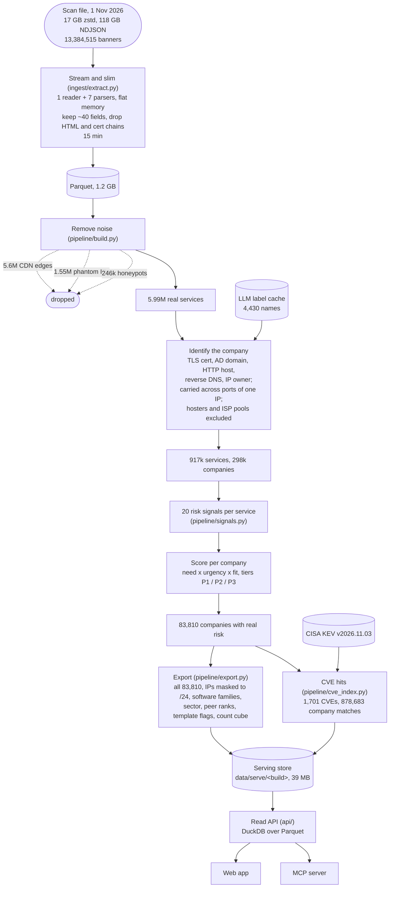
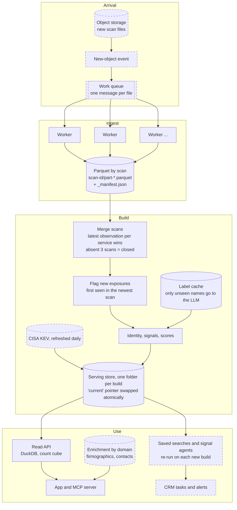
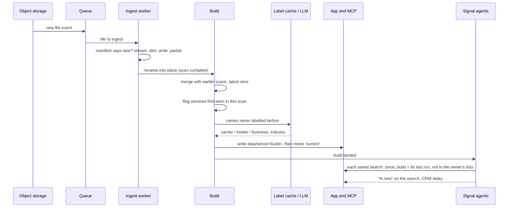
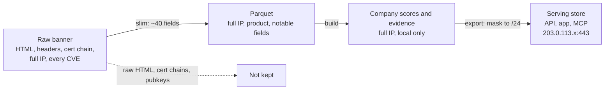
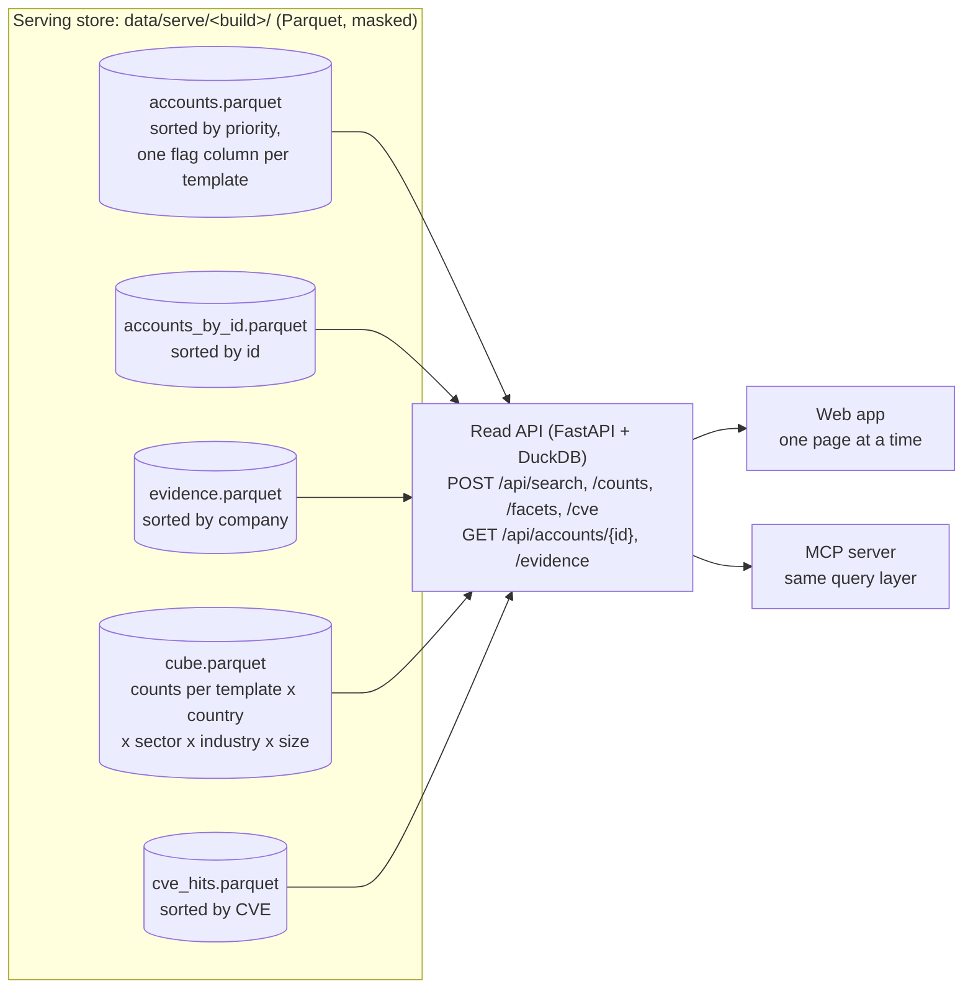

# Recon: architecture and data flow

How a scan file becomes ranked accounts, how the app reads them, and how that keeps up when hundreds
to thousands of files arrive each month. Each diagram marks what is **built** (in this repo, run on the supplied file)
and what is **designed** (the production shape the built pieces slot into).

## 1. What happened to this file (built)

One file, 13.4M banners (about five hours of crawl, 4.1M IPs), processed once. The numbers are what
each step kept.

## 2. Continuous ingestion (designed around the built pieces)

Files are independent, and a zstd file can't be split, so the file is the unit of work.

Solid boxes are built and ran on the supplied file; dashed boxes are designed. Everything from
"Parquet by scan" onwards is the code in this repo.

**Throughput.** Measured: 118 GB raw in 882 s (134 MB/s) on one 8 GB laptop, about 15 minutes per
file. 1,000 files a month is about 250 machine-hours, roughly a third of one machine running
continuously, so a small worker pool handles bursts. The build is SQL over Parquet (DuckDB), so the
same queries move to a warehouse or DuckDB on object storage when one machine is no longer enough.

**Repeat-safe.** Each scan folder carries a `_manifest.json` keyed on the source file's path, size and
modification time, so a re-delivered file is skipped. Shards are written to `scan-id.partial` and
renamed into place only when the whole file is done, so a crashed worker never leaves a scan that
looks finished.

**Incremental (designed, not built).** Today the build recomputes everything in the retained window
(about 4 minutes for 13M rows). That stops working well before a month of files: some inputs are
global (hoster and ISP classification, the score's normalisation, tier ranks, peer ranks), so one file
can move every account. The production build keeps state tables (latest observation per service,
first-seen per service, hostname to domain), merges each file into them, re-scores only the companies
it touched, and recomputes the global statistics on a schedule rather than per file. See section 6.

## 3. One new file arriving

## 4. What is kept, dropped and masked

Full IP addresses never leave the local build: everything the API serves is masked to the /24 network.
The export checks every evidence row for a full IPv4 address and refuses to publish the build if it
finds one, and the deploy script refuses a store whose metadata isn't marked masked.

## 5. Serving: the read API

The app used to download every account as one JSON file and filter in the browser, which capped the
export at the top 15,000 of 83,810 risky companies and would not survive a larger market. Now the
browser holds one page, and everything it shows is computed on the server.

- **Two query paths.** Anything that filters only on template, country, sector, industry and estate
  size (the template counts in the nav and every badge in the profile) is answered from the count
  cube. The cube's size depends on how many of those combinations exist, not on how many accounts
  there are: 7,613 rows at 83k accounts and still 7,613 at 8.4M. Everything else (name search,
  software, identity strength, a list of ids) is SQL over `accounts.parquet`.
- **Badges that answer "what if I pick this?"** Each facet leaves its own filter out, so with GB
  chosen the country badges still show every other country's count given the rest of the profile.
- **Layout does the indexing.** Lookups by id read a copy of the accounts sorted by id, evidence is
  sorted by company and CVE hits by CVE, so Parquet's row-group statistics skip almost every row group
  (account by id: 37 ms at 8.4M accounts, evidence 20 ms). A ranked page is DuckDB's top-N, which keeps
  only the rows it needs while scanning.
- **Template rules computed once per build.** Each rule (an OR of AND clauses, stored as data in the
  catalogue) is evaluated by the export into a boolean column. Queries read one column instead of
  testing signal lists on every row, and a test checks every column against its rule.
- **New builds without downtime.** The export writes `data/serve/<build>.partial`, checks it, renames
  it and swaps the `current` link; the API notices the pointer moved and opens the new build. The last
  three builds are kept for rollback and for diffs.
- **One query layer.** The MCP server calls the same `api/store.py`, so an assistant and the app can't
  disagree about a count.

### How it scales

`uv run python -m api.bench` times every query the app makes, uncached, over the real store and over
synthetic stores 10× and 100× its size (every account copied with its evidence, priorities jittered so
the copies interleave; country, sector, industry and size keep their real distribution). Median of 15
runs, MacBook Air, 8 GB RAM:

| Query (ms, median) | 1× (83,744) | 10× (837,440) | 100× (8,374,400) |
| --- | --- | --- | --- |
| Template counts (cube) | 0.8 | 0.8 | 0.8 |
| Profile badges (cube) | 3.2 | 3.3 | 3.3 |
| First page, whole market | 8.1 | 14 | 70 |
| First page, template + profile | 7.4 | 23 | 91 |
| Page 50 (offset 5,000) | 16 | 17 | 76 |
| Name search | 9.8 | 29 | 158 |
| Template counts (live, strong identity) | 2.0 | 8.1 | 70 |
| Toolbar facets (live) | 4.0 | 12 | 91 |
| Account by id | 3.0 | 5.3 | 37 |
| Evidence by id | 1.8 | 2.6 | 20 |
| CVE search (OpenSSH CVE) | 30 | 99 | — |
| Store size | 45 MB | 301 MB | 879 MB |
| Cube rows | 7,613 | 7,613 | 7,613 |

What this says:

- **The counts don't grow.** The nav counts and the profile badges, the queries the app sends most
  (every click in the profile), come from the cube in 1 to 3 ms at every size: the cube has 7,613 rows
  at 83k accounts and at 8.4M.
- **The live paths grow less than linearly and stay interactive.** At 8.4M accounts, 100 times
  today, a filtered ranked page takes about 90 ms and the toolbar badges about 90 ms on one laptop.
  Name search (160 ms) is a scan; a search index is the fix when it matters. CVE search was measured to
  10× (100 ms); at 100× its 88M-row table needs the same treatment as the accounts (partition by CVE).
- **Keep the batch build off the serving machine.** Measured while a re-export ran on the same
  laptop, the 100× live paths took 0.3 to 1.5 s, five to ten times slower. Ingest and build run on
  workers; the API runs alone.
- **Where it changes.** Past roughly ten times this (tens of millions of accounts, many concurrent
  users), the same API moves onto a store with real indexes: ClickHouse (or Postgres with the right
  indexes) partitioned by country, a search index for names, and the cube materialised per build. The
  API contract, the app and the MCP server stay as they are.
- **The served table grows with companies, not banners.** Raw records grow with every file (billions
  a year); the served table is one row per company with real risk. 13.4M banners give 83,810 of them,
  and there are a few hundred million companies in the world at most, so the read side meets
  "millions" long before "billions". The billions stay in the batch layer: Parquet partitioned by
  observation date and SQL that moves to a warehouse unchanged.

## 6. Scale review: what holds, what changed, what is designed

A separate review looked for decisions that would not hold at 10×, 100× or 1,000× the files, or with
many users. Each finding was checked against the code and the data before acting on it.

| Finding | Status |
| --- | --- |
| The app downloads every account and filters in the browser, so the export was capped at 15,000 | **Fixed:** read API, count cube, all 83,810 accounts served |
| A file is about five hours of crawl (21:13 to 02:06), but retention was "the last 3 files" and "new" meant "first seen in the newest file", so a file covering a fresh IP range would look entirely new | **Fixed:** 30-day retention by observation time; new means first seen in the last 7 days on an IP the crawl already knew (`tests/test_build_scans.py`) |
| Company id ties broken arbitrarily: about 15% of certificates name several domains at the same priority | **Fixed:** deterministic tie-break. It showed why ids matter: the change renamed 1,179 accounts between two builds, which "new since you last ran it" would have reported as new, so the export re-baselines (`--rebaseline`) when the rules change. **Designed:** a company registry with aliases (`acme.co.uk` and `acme.com`, `org:Acme` gaining a domain), so renames neither look new nor orphan list entries |
| Publishing was in place: a reader could see a half-written export | **Fixed:** versioned store, checked before an atomic pointer swap |
| No history: each build overwrote the last | **Partly fixed:** last three builds kept; each account records the build it was first ranked in, which is what "new since you last ran this search" uses. **Designed:** a per-build diff table (entered P1, fixed since last scan) |
| Schema changes would break reads of older scans | **Fixed:** `union_by_name` when reading scans. **Designed:** a schema version in each scan's manifest |
| Hard-coded dates (certificate expiry against 1 December, scan date strings) | **Fixed:** expiry relative to when the service was seen; scan dates come from the data |
| The build recomputes everything, and some inputs are global (hoster detection, score normalisation, tiers, peer ranks) | **Designed:** state tables merged per file, touched companies re-scored, global statistics on a schedule (section 2). The docs no longer claim this is built |
| Steps bound by Python memory: 3.8M distinct hostnames resolved in Python each build, peer ranks in Python | **Designed:** a persistent resolved-name table (only new names resolved), peer ranks as SQL window functions |
| 3,513 small Parquet files (~350 KB) for one input | **Designed:** one writer per worker with ~128 MB row groups, partitioned by observation date |
| KEV status: scoring uses the scanner's flag, CVE search uses today's CISA catalogue | **Designed:** join the catalogue in the build, so a CVE added to KEV after the scan raises the score |
| Thresholds are counts over whatever data is retained (hoster needs 10 domains, ISP pool 20 PTR IPs) | **Partly addressed** by the fixed 30-day window. **Designed:** ratios within the window |
| Ingest idempotency keyed on path, size and modification time | **Designed:** content hash, scan id derived from the observation times |
| Data-quality gates | **Partly fixed:** the export fails on a full IP, duplicate ids or evidence for unknown accounts. **Designed:** row-count and null-rate drift checks against the previous build |
| LLM label cache has no model or prompt version | **Designed:** version in the cache key; relabel on change |
| Per-user state (lists, statuses, saved searches) lives in the browser | **Designed:** the app database (Postgres): lists, list items, saved searches, runs; a scheduler re-runs saved searches per build |

Already fine at scale, left alone: ingest streams with bounded memory and renames atomically, DuckDB
spills to disk, CVE results grow with the number of CVEs rather than companies, evidence is capped
per company, and LLM cost grows with distinct new names, not records.
