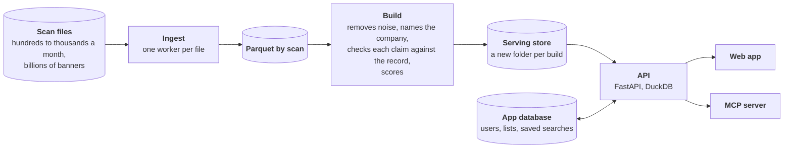
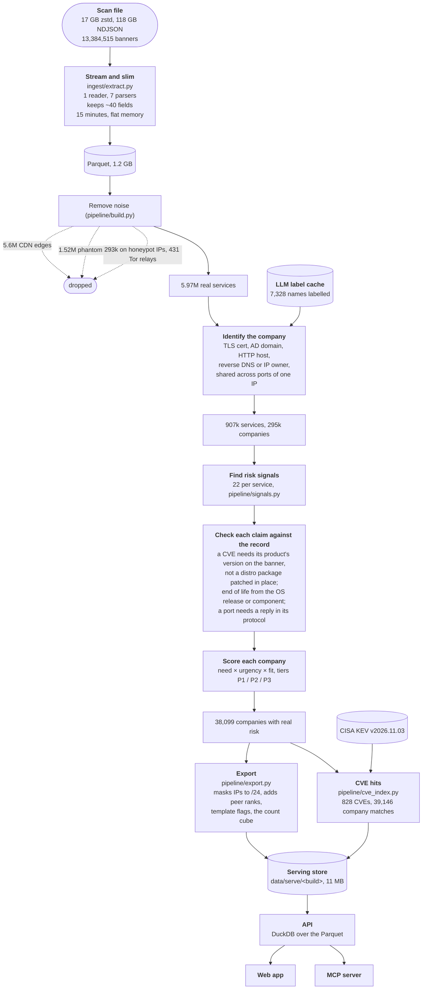
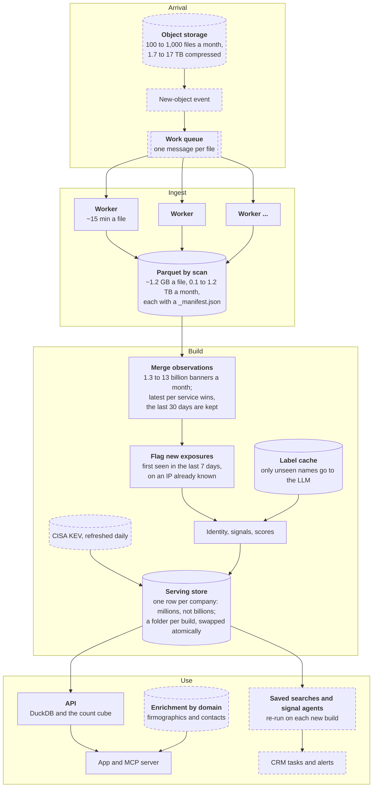
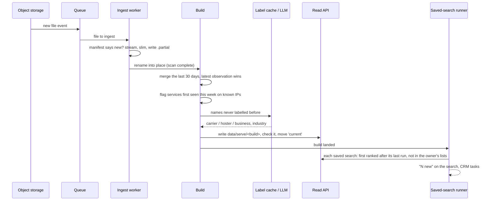
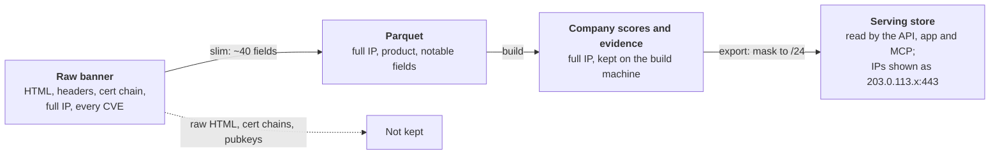
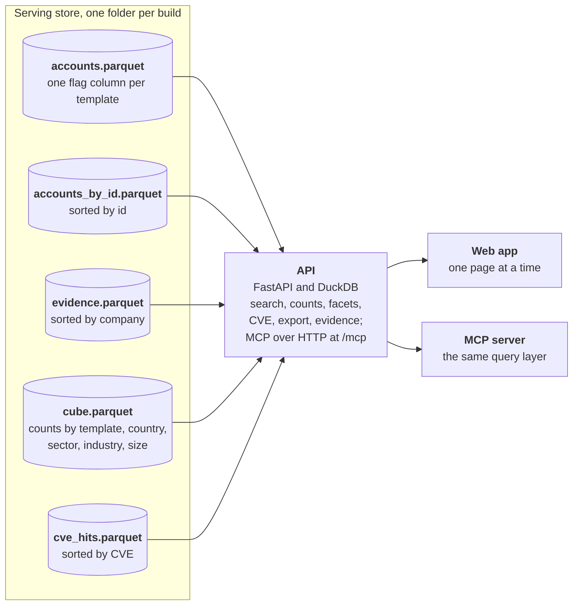
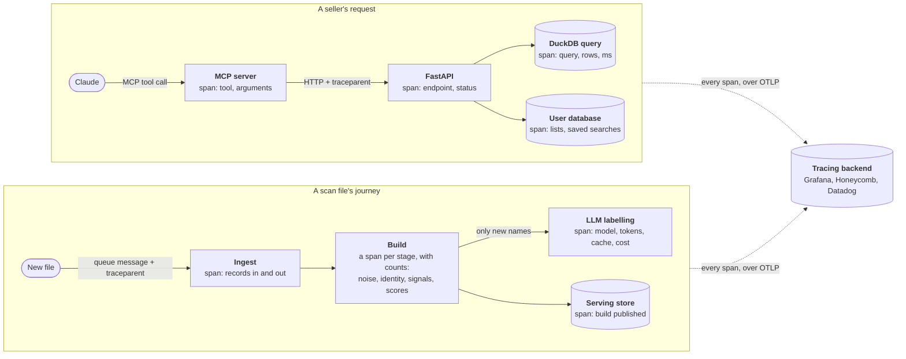

# Recon: architecture and data flow

Recon has three layers for scan data, each sized for a stream of hundreds to thousands of files a month,
and one small store for what users do with it:

1. **Batch:** each scan file is streamed once into Parquet, then a SQL build turns the retained
   observations into scored companies.
2. **Serving store:** every build publishes a versioned, IP-masked set of Parquet files, laid out for
   the queries the product makes, plus a pre-aggregated count cube.
3. **API:** FastAPI. It queries the serving store with DuckDB and keeps each user's lists, statuses,
   saved searches and profile in the app database. The web app and the MCP server both go through
   it, so they always give the same answer.

Diagrams mark what runs in this repo on the supplied file (solid) and the production pieces it slots
into (dashed).

## 1. One file through the pipeline

The supplied file: 13.4M banners covering about five hours of crawl (2026-10-31 21:13 to 2026-11-01
02:06 UTC) over 4.1M IPs. The numbers are what each step kept.

## 2. A continuous stream of files

A zstd file can't be split and files are independent, so the file is the unit of work.

- **Volume.** The brief's hundreds to thousands of files a month, at this file's size (13.4M banners,
  17 GB compressed), is 1.3 to 13 billion banners and 1.7 to 17 TB compressed a month, 0.1 to 1.2 TB
  once slimmed to Parquet. The served side is one row per company with real risk, so it grows with
  companies (38k from this file), not with banners.
- **Throughput.** 118 GB raw in 882 s (134 MB/s) on one 8 GB laptop, about 15 minutes per file.
  1,000 files a month is about 250 machine-hours, a third of one machine running continuously, so a
  small worker pool absorbs bursts.
- **Repeat-safe ingest.** Each scan folder carries a `_manifest.json` keyed on the source file, so a
  re-delivered file is skipped. Shards are written to `scan-id.partial` and renamed only when the
  whole file is done, so a crashed worker never leaves a scan that looks finished.
- **Time, not files, defines the window.** A file is a few hours of an ongoing crawl, not a re-scan
  of the internet. The build keeps the latest observation of each `ip:port:transport` seen in the
  last 30 days. A service is *new* when it was first observed in the last 7 days on an IP the crawl
  had already seen before then, so a file that covers a fresh IP range doesn't make everything in it
  look new. New exposure raises urgency ×1.3 and feeds the "Newly exposed" template.
- **Schema evolution.** Scans are read with `union_by_name`, so a field added later reads as null in
  older scans instead of breaking the build.
- **Deterministic identity.** Account ids are the keys that lists and saved searches hold, so every
  identity choice has a total order: when a certificate names several domains at the same priority,
  the tie is broken by name. A rebuild of the same data gives the same ids.

## 3. One new file arriving

## 4. What is kept, dropped and masked

Full IP addresses never leave the local build: everything the API serves is masked to the /24 network.
The export checks every evidence row for a full IPv4 address and refuses to publish the build if it
finds one, and the deploy script refuses a store whose metadata isn't marked masked.

## 5. Serving: the read API

The browser never holds the market. It asks for one page of accounts, the counts and the filter
badges, and the API computes each of them over the serving store.

- **Two query paths.** Anything that filters only on template, country, sector, industry and estate
  size (the template counts in the nav and every badge in the profile) is answered from the count
  cube. The cube grows with the number of those combinations, not with accounts: about 6,600 rows at
  38k accounts and the same at 3.8M. Everything else (name search, software, identity strength, a
  list of ids, "not in my lists") is SQL over `accounts.parquet`.
- **Badges that answer "what if I pick this?"** Each facet leaves its own filter out: with GB chosen,
  the country badges still show what every other country would add under the rest of the filters.
- **Layout does the indexing.** Lookups by id read a copy of the accounts sorted by id, evidence is
  sorted by company and CVE hits by CVE, so Parquet's row-group statistics skip almost every row group.
  A ranked page is DuckDB's top-N, which keeps only the rows it needs while scanning.
- **Template rules computed once per build.** Each rule (an OR of AND clauses, stored as data in the
  catalogue) is compiled to SQL and evaluated by the export into a boolean column, so a query reads one
  column instead of testing signal lists on every row. A test checks every column against its rule.
- **Builds swap atomically.** The export writes `data/serve/<build>.partial`, checks it (no full IPs,
  unique ids, no evidence for unknown accounts), renames it and moves the `current` link. The API
  opens the new build on its next request, with no restart. The last three builds are kept for
  rollback and comparison.
- **One query layer, two ways in.** The MCP server calls the same `api/store.py` as the HTTP API, so an
  assistant and the app can't disagree about a count. The hosted app serves it at `/mcp` (MCP's
  streamable HTTP transport, stateless JSON calls behind a bearer token) from the API's own process,
  and locally it runs over stdio.
- **Scan data is read-only to the API.** The build is the only writer of the serving store, so serving
  needs no locking and scales by adding read replicas of the same files; the only writes are users'
  lists and searches, in the app database (section 6).

### Measured at 1×, 10× and 100×

`uv run python -m api.bench` times every query the app makes, uncached, over the real store and over
synthetic stores 10× and 100× its size. Each account is copied with its evidence and CVE rows, its
priority jittered so the copies interleave, and country, sector, industry and size keep their real
distribution. Median of 15 runs on a MacBook Air with 8 GB RAM:

| Query (ms) | 38,099 accounts | 380,990 | 3,809,900 |
| --- | --- | --- | --- |
| Template counts (cube) | 0.8 | 0.8 | 0.8 |
| Profile badges (cube) | 3.3 | 3.3 | 3.3 |
| Ranked page, whole market | 6.8 | 12 | 38 |
| Ranked page, template + profile | 6.4 | 22 | 50 |
| Page 50 (offset 5,000) | 13 | 50 | 46 |
| Name search | 8.2 | 19 | 74 |
| Template counts (live, strong identity) | 2.0 | 5.0 | 37 |
| Toolbar badges (live) | 3.7 | 8.5 | 52 |
| Account by id | 2.9 | 3.9 | 18 |
| Evidence by id | 1.7 | 1.8 | 9.7 |
| CVE search (an OpenSSH CVE) | 14 | 31 | not run |
| Store size | 11 MB | 54 MB | 383 MB |
| Cube rows | 6,638 | 6,638 | 6,638 |

- **The most frequent queries don't grow.** The nav counts and the profile badges, sent on every
  click in the profile, come from the cube in 1 to 3 ms at every size.
- **The live paths stay interactive at 100×.** A filtered, ranked page and the toolbar badges take
  about 50 ms at 3.8M accounts on one laptop. Name search (74 ms) is a scan, the first candidate for a
  search index. CVE search runs to 10×; at 100× its table is partitioned by CVE in production.
- **Batch and serving run on separate machines.** Measured while a re-export ran on the same laptop,
  the 100× live paths took 0.3 to 1.5 s, five to ten times slower.
- **The served table grows with companies, not banners.** Raw records grow with every file, billions
  a year; the served table is one row per company with real risk. 13.4M banners give 38,099 of them,
  and there are a few hundred million companies in the world at most, so the read side meets millions
  long before billions. The billions stay in the batch layer, as Parquet and SQL.

## 6. Lists and saved searches

A seller works in **lists** (named sets of accounts, each account with one status: to contact,
contacted, meeting booked, not a fit) and **saved searches** (a view, its filters and the profile it
was saved with).

- **"New since you last ran it" comes from the data.** Each account records the build it was first
  ranked in (`first_ranked`, carried over from build to build by id). A saved search remembers the
  build it last ran on, so "new since then and in none of my lists" is one query:
  `first_ranked > last_run` and `id not in (my listed ids)`. Nothing per user is snapshotted, however
  large the results.
- **Re-baselining.** `first_ranked` follows account ids, so a change to the identity rules (which can
  rename a company) is published with `--rebaseline`, marking everything present as already seen.
  Otherwise renamed companies would surface as new.
- **Where the state lives: the app database, behind the API.** Users, sessions, lists, list items,
  account statuses, saved searches and profiles ([`api/workspace.py`](../api/workspace.py)). Every row
  belongs to a workspace; each user has one, and a team is a membership table away. The app, the
  HTTP API and the MCP server all read and write the same rows, so a list Claude builds is the list
  the seller opens. "This list" and "not in my lists" are resolved on the server, so the browser
  never sends id lists, and caps per workspace (50 lists, 20,000 listed accounts, 50 saved searches)
  bound what one user can store.
- **SQLite here, Postgres in production.** The two stores have different jobs. Scan data is a
  column workload (scans and aggregates over millions of rows, rebuilt per batch), so it is Parquet
  read by DuckDB. User state is a row workload (small, frequent writes that must not be lost), so it
  needs a transactional row store. This deployment runs one API host, where SQLite in WAL mode
  (many readers, one writer, millisecond writes) is enough and needs no server. Production uses
  Postgres: several API instances writing the same rows, teams editing one list, backups with
  point-in-time recovery. The queries are portable SQL and live in one module, so the move is a
  change of driver and connection, not of design.
- **Signed in, everything.** Every route except health and sign-in needs a session: the account list
  names companies with exploitable exposure, and an unlisted URL is not a secret (every TLS
  certificate is published in Certificate Transparency logs, which scanners watch). Passwords are
  stored as scrypt hashes from configuration, sessions as hashed tokens in an HttpOnly, SameSite
  cookie, and sign-in is rate-limited at nginx. Production replaces the password with SSO (OIDC) and
  maps identity-provider groups to team workspaces.
- **Saved searches, run on new data.** Each saved search can be reviewed in the app or asked through
  the MCP server (`whats_new`). In production a runner re-executes every daily search when a build
  lands and notifies its owner, through the same API.

## 7. The production path

What runs here is sized for this file and for 10 to 100 times more accounts. These are the changes
for a full stream of files and many users, with the point at which each is needed:

| Part | In this repo | At production scale |
| --- | --- | --- |
| Build | Recomputes the 30-day window: about 4 minutes for 13M observations | State tables (latest observation per service, first seen per service, hostname to domain) merged per file; only touched companies re-scored; global statistics (hoster detection, score normalisation, tiers, peer ranks) recomputed on a schedule. Needed once a rebuild no longer fits between files |
| Name resolution and peer ranks | Python over the distinct hostnames (3.8M) and all scored companies | A persistent resolved-name table, so only new names are resolved; peer ranks as SQL window functions |
| Parquet layout | One shard per 32 MB of input | One writer per worker with ~128 MB row groups, partitioned by observation date |
| Company identity | Deterministic choice per build | A company registry with aliases (`acme.co.uk` and `acme.com`, an IP owner gaining a domain), so renames neither look new nor orphan list entries |
| KEV in scoring | The scanner's KEV flag at scan time | The CISA catalogue joined in the build, so a CVE added to KEV after the scan raises the score |
| Thresholds (hoster, ISP pool) | Counts over the 30-day window | Ratios within the window |
| Ingest idempotency | Keyed on source path, size and modification time | Content hash; scan id from the observation times |
| Data quality | The export fails on a full IP, duplicate ids or orphan evidence | Plus row-count and null-rate drift checks against the previous build |
| LLM label cache | Keyed by name | Keyed by name, model and prompt version, so a prompt change relabels |
| LLM labelling cost | Claude Haiku, 40 names a request, only names never labelled before | The Batch API (half price, results within the day); a cheap first-stage classifier so only uncertain names reach the LLM ([technical notes §7](technical-notes.md#7-where-an-llm-is-used-how-its-checked-and-what-it-costs)) |
| Observability | Build funnel counts in `funnel.json`, LLM tokens per run in `llm_usage.json` | OpenTelemetry traces across every service, below |
| Serving store | Parquet on local disk, DuckDB in the API process | Past tens of millions of accounts or many concurrent users: the same API on ClickHouse (or Postgres with indexes), partitioned by country, a search index for names, the cube materialised per build |
| User state | SQLite in WAL mode on one API host | Postgres: several API instances, teams sharing workspaces, point-in-time recovery; a runner that re-executes saved searches per build and notifies |
| Sign-in | Configured users with scrypt-hashed passwords, server-side sessions | SSO (OIDC), identity-provider groups mapped to team workspaces, audit log |

Unchanged at any scale: ingest streams with bounded memory and renames atomically, DuckDB spills to
disk, CVE results grow with the number of CVEs rather than companies, evidence is capped per company,
and LLM cost grows with distinct new names, not records.

### Tracing a request end to end

This is the production design; none of it is built yet. In production Recon is several services: ingest workers, build workers, the labelling job, the FastAPI
read API, the MCP server and the web app. I'd use OpenTelemetry so that any request can be followed
through all of them as one trace. Each service passes the trace context on: the standard W3C
`traceparent` header on HTTP calls, and a message attribute on the work queue. Every span then joins
the same trace, whichever service it was recorded in.

- **A seller's request.** Claude calls an MCP tool, the MCP server calls the API, and the API queries
  DuckDB and the user database. One trace shows where the time went and which step failed.
- **A scan file's journey.** A new file lands, a worker ingests it, and the build removes noise, names
  companies, labels new names and scores. Each stage is a span carrying its record counts, so the trace
  shows how long a file takes to reach sellers, and whether a stage behaved oddly (a sudden jump in
  honeypots, say, or a drop in companies identified).
- **The LLM's cost rides on the same traces.** The Anthropic SDK can emit spans with the model, tokens
  and cache use in OpenTelemetry's standard GenAI fields, so cost per file sits next to latency, and a
  file that suddenly costs ten times the usual raises an alert.

FastAPI and HTTP clients have ready-made OpenTelemetry instrumentation; the pipeline stages and MCP
tools need a span each, opened where the funnel counts are already computed.
